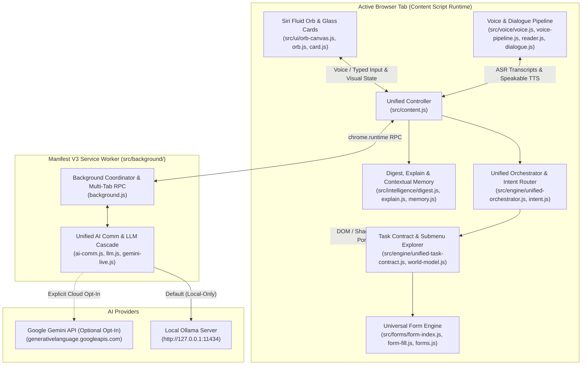
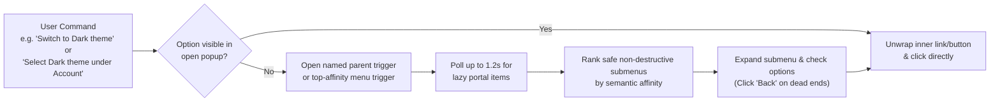

# Sleepwalker — AI Browser Copilot (Chrome Extension)

**Sleepwalker** is a privacy-first Manifest V3 **AI Browser Copilot** Chrome Extension featuring a 60 FPS Siri-inspired liquid-glass voice & text interface, intelligent DOM & Shadow-DOM navigation, multi-level hierarchical & blind submenu discovery, universal web form automation, multi-tab control, and instant webpage summarization powered by **Local Ollama** or **Google Gemini**.

## Demo Video

- **[Watch the Sleepwalker Demo Video (Google Drive)](https://drive.google.com/file/d/1Ue-pk6MQmsGaCiGdGQhCr2D5Xg0gSd7T/view?usp=sharing)**

---

## Table of Contents

1. [Key Capabilities](#key-capabilities)
2. [System Architecture](#system-architecture)
3. [Project Directory Structure](#project-directory-structure)
4. [Detailed Step-by-Step Setup Guide](#detailed-step-by-step-setup-guide)
5. [AI Provider Configuration (Local Ollama & Google Gemini)](#ai-provider-configuration-local-ollama--google-gemini)
6. [Voice, Keyboard Shortcuts & Example Commands](#voice-keyboard-shortcuts--example-commands)
7. [Security & Privacy Model](#security--privacy-model)

---

## Key Capabilities

- **Siri-Inspired 60 FPS Liquid-Glass UI** (`src/ui/`): Multi-layer organic fluid canvas orb (`idle`, `listening`, `processing`, `executing`, `speaking`, `completed`, `error`), floating frosted-glass cards, and a conflict-free **Type** command bar that automatically pauses speech recognition while typing and prevents outside-click dismissal of open webpage menus.
- **Natural Voice Pipeline & Continuous Dialogue** (`src/voice/`): Web Speech recognition with bilingual/multilingual support (`en-IN`, `en-US`, `hi-IN`, and 10+ locales), speakable Markdown/URL sanitization, human-paced sentence TTS chunking, and contiguous-phrase echo suppression.
- **Hierarchical Menu & Blind Submenu Explorer** (`src/engine/`): Navigates Polymer/Shadow-DOM portals (`<tp-yt-iron-dropdown>`), Radix/MUI/AntD popovers, hover mega-menus, and multi-page drill-down menus — finding nested options even when the user does not know the intermediate submenu or parent trigger (with automatic `Back` recovery on dead ends).
- **Universal Web Form Engine** (`src/forms/`): W3C AccName 1.2 `aria-labelledby` and question-card heading resolution for **Google Forms**, Microsoft Forms, React/Vue/Angular controlled inputs, ARIA `radiogroup` / `checkbox` / `listbox` / `combobox`, and native HTML5 controls, with per-field read-back verification.
- **Multi-Tab Context & Webpage Intelligence** (`src/background/`, `src/intelligence/`): List, open, switch, and close tabs by natural language; summarize, explain, or read aloud any webpage locally via **Ollama** or optionally via **Google Gemini**.

---

## System Architecture

### 1. High-Level Extension Architecture



### 2. Hierarchical & Blind Submenu Discovery Flow



---

## Project Directory Structure

```text
sleep/
├── manifest.json                         # Chrome Extension Manifest V3 configuration
├── README.md                             # Documentation, setup guide & architecture
├── .env.example                          # Optional local environment variable template
├── .gitignore                            # Excludes .env and *.local.js secrets
├── icons/                                # Extension toolbar & store icons (16/48/128px)
├── data/
│   ├── lexicon.json                      # Multilingual command & synonym lexicon
│   └── link-lexicon.json                 # Navigation & link-matching lexicon
├── pages/
│   ├── options.html / options.js         # AI provider, voice, rate & privacy settings UI
│   ├── mic-setup.html / mic-setup.js     # Microphone permission onboarding & diagnostics
│   ├── offscreen.html / offscreen.js     # MV3 offscreen audio/speech helper
│   └── shelf.html / shelf.js             # Local document shelf manager for form uploads
└── src/
    ├── content.js                        # Main content-script lifecycle & turn coordinator
    ├── background/
    │   ├── background.js                 # MV3 service worker, tab RPC & script injection
    │   ├── llm.js                        # LLM cascade (Local Ollama -> optional Gemini -> offline)
    │   ├── gemini-live.js                # Optional Gemini Live session client
    │   ├── ai-comm.js                    # Unified streaming/request AI communication layer
    │   └── cdp-ownership-manager.js      # Optional Chrome Debugger tab session coordinator
    ├── ui/
    │   ├── ui.css                        # Shadow-DOM scoped glassmorphism & responsive layout
    │   ├── orb-canvas.js                 # 60 FPS multi-layer organic liquid-glass canvas renderer
    │   ├── orb.js                        # Floating orb dock, status bar & Type input bar
    │   ├── card.js                       # Frosted response, choice, confirm & summary cards
    │   └── threads.js                    # Ambient waveform thread visualizer
    ├── voice/
    │   ├── voice-pipeline.js             # toSpeakable(), sentence chunker & EchoTracker
    │   ├── voice.js                      # Web Speech API state machine & auto-recovery
    │   ├── reader.js                     # SpeechSynthesis TTS reader with word/sentence tracking
    │   └── dialogue.js                   # Continuous conversation loop, barge-in & prompts
    ├── forms/
    │   ├── form-index.js                 # W3C AccName 1.2 & Shadow-DOM/iframe form indexer
    │   ├── form-fill.js                  # Controlled-input setter, ARIA widget & batch filler
    │   ├── forms.js                      # Guided step-by-step form dictation, profile & undo
    │   ├── shelf-db.js                   # IndexedDB local file shelf storage
    │   ├── upload.js                     # File input matching & attachment helper
    │   └── camera.js                     # Webcam capture card for photo upload fields
    ├── engine/
    │   ├── unified-orchestrator.js       # Natural-language intent router & multi-step planner
    │   ├── unified-task-contract.js      # Verified DOM execution & blind submenu explorer
    │   ├── extension-intelligence.js     # Loop detector, click shield & context ledger
    │   ├── browser-engine.js             # Observation cache, menu path & action engine
    │   ├── stagehand-browser-adapter.js  # Optional CDP precision input adapter
    │   ├── world-model.js                # Live interactive control & section hierarchy graph
    │   ├── nav-engine.js                 # Turn state machine (AgentFSM) & action verifier
    │   ├── navigate.js                   # Semantic link & section navigation controller
    │   ├── element-select.js             # Fuzzy & phonetic interactive element selector
    │   ├── link-index.js                 # Visible link & landmark indexer
    │   ├── link-intent.js                # Link/navigation intent classifier
    │   ├── match.js                      # Phonetic skeleton, edit-distance & Indic transliteration
    │   └── intent.js                     # Fast deterministic & lexicon-backed intent parser
    └── intelligence/
        ├── explain.js                    # Streaming webpage explanation & Q&A controller
        ├── digest.js                     # Clean article/section DOM content extractor
        ├── outline.js                    # Heading hierarchy extractor & smooth section jumper
        ├── memory.js                     # Cross-page session state & coreference resolver
        ├── task-planner.js               # Multi-step browsing progress tracker
        ├── personal-intel.js             # Opt-in local preference & context helper
        ├── confirm.js                    # Consequential-action user confirmation gate
        ├── teach.js                      # User-demonstrated workflow recording & replay
        └── diagnostics.js                # Structured ring-buffer telemetry & turn tracing
```

---

## Detailed Step-by-Step Setup Guide

### Prerequisites
- **Browser**: Google Chrome (v116+), Microsoft Edge, or Brave (Desktop).
- **Optional (Recommended for Local AI)**: [Ollama](https://ollama.com/download) installed locally for 100% private, offline webpage summarization and reasoning.
- **Optional (Cloud AI)**: A [Google AI Studio (Gemini) API Key](https://aistudio.google.com/) if you prefer cloud inference.

---

### Step 1 — Clone the Repository

```bash
git clone https://github.com/vatsalpro/sleep.git
cd sleep
```

### Step 2 — Load the Extension in Chrome

1. Open Google Chrome and navigate to:
   ```text
   chrome://extensions
   ```
2. Enable **Developer mode** using the toggle in the **top-right corner**.
3. Click **Load unpacked** (top-left button).
4. Select the cloned **`sleep`** folder (the directory containing `manifest.json`).
5. Click the **Extensions puzzle icon** in Chrome's toolbar and click the **Pin** icon next to **Sleepwalker — AI Browser Copilot**.

### Step 3 — Grant Microphone Access (For Voice Mode)

1. Open any normal `https://` website (for example, `https://www.wikipedia.org` or `https://www.youtube.com`).
   *(Note: Chrome blocks content scripts and microphone access on internal `chrome://` pages and the Chrome Web Store.)*
2. Press **`Alt+S`** (or click the **Sleepwalker** toolbar icon) to summon the fluid orb at the bottom of the page.
3. When prompted by Chrome, click **Allow** for microphone access — or click **Allow Microphone / Mic Diagnostics** on Sleepwalker's card to open the built-in setup page (`pages/mic-setup.html`).
4. Prefer typing? Click the **Type** button next to the orb anytime to type commands directly without using a microphone.

---

## AI Provider Configuration (Local Ollama & Google Gemini)

By default, Sleepwalker runs in **Local-Only Privacy Mode** (no page content leaves your machine).

### Option A — Local Ollama Setup (Recommended, Free & Private)

1. Install Ollama from [ollama.com](https://ollama.com) and pull a lightweight model:
   ```bash
   ollama pull llama3.2:3b
   ```
2. Allow Chrome Extension origins to reach your local Ollama server:
   - **Windows (PowerShell)**:
     ```powershell
     [System.Environment]::SetEnvironmentVariable('OLLAMA_ORIGINS', 'chrome-extension://*', 'User')
     # Restart Ollama from the system tray, then run:
     ollama serve
     ```
   - **macOS / Linux**:
     ```bash
     OLLAMA_ORIGINS="chrome-extension://*" ollama serve
     ```
3. Right-click the Sleepwalker toolbar icon → **Options** (`pages/options.html`), verify Ollama URL is `http://127.0.0.1:11434` and Model is `llama3.2:3b`, and click **Save**.

### Option B — Google Gemini API Setup (Optional Cloud Mode)

1. Right-click the Sleepwalker toolbar icon → **Options**.
2. Disable **Local-Only Mode** (explicit cloud opt-in), paste your **Gemini API Key**, choose a model (e.g., `gemini-2.5-flash`), and click **Save**.
   *(Developers can alternatively copy `.env.example` to `.env` locally — `.env` and `config.local.js` are gitignored and never committed.)*

---

## Voice, Keyboard Shortcuts & Example Commands

### Shortcuts
| Shortcut / Control | Action |
| :--- | :--- |
| **`Alt + S`** (or click Orb) | Summon Sleepwalker / start listening |
| **Hold `Alt + Z`** | Push-to-talk (release to execute immediately) |
| **`Alt + Shift + X`** | Global **Emergency Stop** (halts all active actions immediately) |
| **`Type` button** | Toggle typed command bar (pauses mic while typing) |
| **`Escape`** | Close Type bar (if focused) or dismiss Sleepwalker UI |

### Example Commands to Try
- **Page Understanding & Reading**:
  - *"Summarize this webpage"* / *"Explain this page"*
  - *"Read this page"* / *"Pause"* / *"Resume"* / *"Show outline"*
- **Navigation, Menus & Unknown Submenus**:
  - *"Open YouTube"* → *"Select History"* / *"Select Home"*
  - *"Open Account"* → *"Select YouTube Studio"*
  - *"Select Dark theme under Account"* *(automatically discovers `Appearance` submenu)*
  - *"Switch to Dark theme"* *(automatically discovers `Account` → `Appearance` → `Dark theme`)*
  - *"What options are under Account?"*
- **Universal Form Filling (Google Forms & Web Apps)**:
  - *"Fill this form with Name: Alex Carter, Email: alex@example.com, Address: 42 Oak Street, Austin, TX, Phone number: 555-0199, Comments: Testing Sleepwalker"*
  - *"Fill this form"* *(starts interactive step-by-step guided form fill)*
- **Multi-Tab Control**:
  - *"List tabs"* / *"Switch to the GitHub tab"*

---

## Security & Privacy Model

- **Local-Only by Default**: Cloud LLM calls are disabled unless you explicitly opt in via **Options**.
- **Sensitive Field Hard-Block**: Passwords, OTPs, CVVs, card numbers, Aadhaar, PAN, and bank fields are **never** filled programmatically, logged, or sent to any LLM.
- **No Silent Form Submission**: Batch and guided form filling populate and verify fields without auto-submitting; consequential actions require explicit user confirmation.
- **Destructive Action Guard**: Exploratory submenu discovery never clicks `Sign out`, `Delete`, `Buy`, or external navigation links while searching for nested settings.
