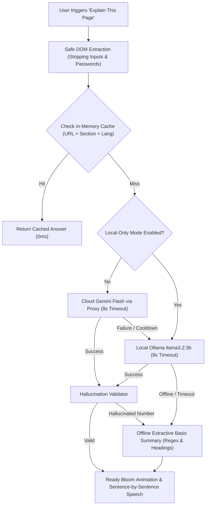

# 🌙 Sleepwalker - Wispr-Flow Voice Assistant for Accessible Web
**CodeQuest National Tech Hackathon 2026 • Manifest V3 Chrome Extension (Plain JavaScript, HTML & CSS — Zero Build Step)**

[](manifest.json)
[-blue?style=flat-square)](background.js)
[](widget.css)
[-orange?style=flat-square)](voice.js)
[](explain.js)
[](https://github.com/vatsalpro/sleep)

---

## 🎯 Executive Summary & Problem Statement

Millions of low-vision, low-literacy, and elderly citizens struggle to navigate complex digital public services — from state scholarship portals and pension schemes to admissions forms. These pages are often walls of bureaucratic text with buried deadlines, complex fee structures, and required document checklists.

**Sleepwalker** turns every webpage into an intuitive, voice-first experience:
1. **Always-On Floating Pill:** A compact, non-intrusive floating pill (Wispr Flow style) rests at the bottom-right of every webpage.
2. **Signature "Explain This Page":** In one click or voice command (*"Explain this page"* or *"पेज समझाओ"*), Sleepwalker extracts the essential purpose, fees, dates, and required documents into a clear, simple summary under 120 words.
3. **Full-Screen Prism Glow:** While the assistant listens and processes, the entire screen borders illuminate in a soft, transparent prism glow (cyan, violet, pink, amber) that blooms bright when the answer is ready, leaving the central 72% of the page completely transparent and readable.
4. **Sentence-by-Sentence Highlight:** Speech synthesis highlights each sentence as it speaks aloud in English (`en-IN`) or Hindi (`hi-IN`).
5. **Strict DOM Privacy:** User passwords, text fields, and form inputs are **100% stripped and excluded**. Credentials are never read aloud or transmitted.

---

## 📁 Project Structure

```text
sleepwalker/ (D:\sleep)
├── manifest.json       # Manifest V3 (activeTab, scripting, storage, offscreen)
├── background.js       # Service worker: toggle, script injector, LLM cascade & offscreen manager
├── content.js          # In-page bootstrap, Alt+S & Alt+Z Hold-to-Talk key listener
├── widget.js           # Shadow DOM UI controller, settings, and module orchestrator
├── widget.css          # Encapsulated styles: pill, glow animations, bubble, high contrast
├── pill.js             # Wispr-Flow floating round pill, equalizer bars, companion bubble
├── glow.js             # Full-screen prism glow edge overlay with center cutout mask
├── explain.js          # Safe extraction, Devanagari normalizer, hallucination validator, offline fallback
├── llm.js              # Cascade engine: Cache -> Cloud Gemini Proxy -> Local Ollama -> Offline Fallback
├── voice.js            # Web Speech API recognition, silence auto-commit, en-IN & hi-IN parser
├── reader.js           # Content extractor, table parser, sentence-by-sentence SpeechSynthesis
├── outline.js          # H1-H4 heading extractor and fuzzy section matcher
├── mic-setup.html      # Microphone onboarding, live Web Audio volume visualizer & hardware report
├── mic-setup.js        # getUserMedia, Web Audio AnalyserNode meter, and speech test
├── offscreen.html      # Offscreen audio document host
├── offscreen.js        # Chromium offscreen speech recognition evaluator & reporter
├── test-sample.html    # Benchmark portal (articles, fees table, documents, login form with password)
├── icons/              # 16px, 48px, 128px high-DPI extension icons
└── proxy/              # Serverless proxy folder (keeps API keys off the client)
    ├── worker.js       # Cloudflare Worker implementation (CORS, rate limiting, Gemini Flash)
    ├── api/explain.js  # Vercel Serverless Function alternative
    ├── .env.example    # Environment variable template
    └── README.md       # Proxy deployment and security guide
```

---

## ⏱️ 2-Minute Judge Demo Script

> **Judge Hook:** *"Judges, navigating government portals is difficult for elderly or visually impaired citizens. Let me show you how Sleepwalker makes any confusing website accessible in under 10 seconds."*

### Step 1: Show the Always-Available Floating Pill (0:00 - 0:25)
1. Open Chrome and navigate to the benchmark test portal:
   `http://localhost:8000/test-sample.html`
2. Point out the bottom-right corner:
   *"Notice the floating pill. It sits on the page without shifting the layout or triggering CSP warnings because it's completely isolated in an open Shadow DOM. You can drag it anywhere and Chrome remembers its position across reloads."*

### Step 2: Signature "Explain This Page" & Prism Glow (0:25 - 1:00)
1. Click the pill to expand the companion bubble, then click **"✨ Explain"** (or press <kbd>Alt+Z</kbd> and say *"Explain this page"*):
   *"Watch the screen borders: 4 soft prism color blobs drift smoothly along the edges. Notice how the center of the screen stays 100% transparent and readable thanks to a radial gradient cutout mask."*
2. After processing, the glow blooms bright for 600ms, transitions to calm breathing, and Sleepwalker reads the summary aloud sentence-by-sentence with visual highlighting:
   *"Sleepwalker extracted the core purpose, the 1,200 INR fee, the January 15 deadline, and required documents. The source badge clearly marks whether this came from Cloud Gemini, Local Ollama, or our Offline Basic Summary."*

### Step 3: Strict DOM Privacy Verification (1:00 - 1:25)
1. Scroll down to the **Applicant Portal Sign-in Form**:
   *"Notice there is a login form with an applicant name and a password field with a secret password. Sleepwalker's Safe Text Extractor explicitly skips all input, textarea, and password fields. Passwords and personal data are NEVER captured, read aloud, or sent to AI models."*

### Step 4: Bilingual Hindi Support & Full Side Panel (1:25 - 1:45)
1. Press <kbd>Alt+S</kbd> to slide open the full assistant side panel.
2. Click **"🇮🇳 EN"** to switch to **"🇮🇳 HI"** (Hindi).
3. Click **"📑 Outline"** or say *"आउटलाइन"*:
   Sleepwalker lists all 6 headings in the sidebar with 1-click read buttons for low-vision users.

### Step 5: Wrap-up & Architecture (1:45 - 2:00)
*"Sleepwalker has zero build step, zero npm runtime dependencies, runs completely unpacked in Chrome Manifest V3, and supports both Cloud Gemini and 100% local Ollama with offline fallback."*

---

## 🚀 Installation Guide

1. Open **Google Chrome** (or Edge / Brave).
2. Navigate to `chrome://extensions`.
3. Toggle ON **Developer mode** in the top-right corner.
4. Click **Load unpacked** in the top-left corner.
5. Select the project directory:
   ```text
   D:\sleep
   ```
6. The **Sleepwalker - Voice Web Assistant** card will appear immediately.
7. Click the Chrome Extensions puzzle icon and **Pin** Sleepwalker to your toolbar.

> [!TIP]
> If testing on local HTML files via `file:///`, click **Details** on the Sleepwalker extension card in `chrome://extensions` and turn ON **"Allow access to file URLs"**.
> Testing on any HTTP/HTTPS site (like Wikipedia or our local test server at `http://localhost:8000/test-sample.html`) works out of the box with zero extra steps.

---

## 🧠 Architecture & AI Cascade

Sleepwalker implements an enterprise-grade 4-step cascade inside the background service worker:



### 1. Safe Text Extraction & Privacy Guard
- Extracts visible content from `<main>`, `<article>`, `[role=main]`, or body.
- Strictly ignores `nav`, `footer`, `header`, `script`, `style`, `noscript`, and `iframe`.
- **Absolute Privacy Rule:** All `input`, `textarea`, `select`, `button`, and `password` nodes are stripped. Passwords or entered text cannot be leaked.

### 2. Hallucination Validator
- Normalizes Devanagari numerals (`०-९`) to standard ASCII digits (`0-9`).
- Scans model output for numbers, currency figures, and dates.
- Cross-references every number against the source page text. If a model hallucinates a date or fee (e.g. inventing *"fee is 5,000 INR"* when the page states 1,200 INR), the invalid sentence is dropped or the system falls back to the deterministic offline summary.

### 3. Serverless Proxy (`/proxy`)
- Cloudflare Worker (`proxy/worker.js`) and Vercel function (`proxy/api/explain.js`).
- Never exposes the `GEMINI_API_KEY` on the client.
- Rate-limited per IP (30 requests/minute) with CORS restricted to Chrome extensions.
- Zero-logging architecture: user page text is never written to server logs.

---

## 🎙️ Microphone Architecture & Honest Findings

### Chromium MV3 Offscreen Evaluation
- **What We Tested:** We created an extension onboarding page (`mic-setup.html`) requesting `getUserMedia` to store permission for the extension origin, and built `offscreen.html` / `offscreen.js` with `chrome.offscreen` (reason: `USER_MEDIA`) to test extension-wide speech recognition.
- **Honest Finding for Judges:** In current stable Chromium builds, `webkitSpeechRecognition` fails or is blocked inside headless offscreen documents (Chromium Issue 1423238: Web Speech API requires an active, focused render window with a direct user gesture). Additionally, extension origin permissions do not bypass cross-origin security on external websites.
- **Our Dual Architecture Solution:**
  1. Sleepwalker probes offscreen recognition, but seamlessly falls back to **per-site content-script recognition**.
  2. When a user activates voice on a new website, Chrome displays the standard permission prompt once for that site. Chrome remembers the permission permanently for that origin.
  3. **100% Typed Input Fallback:** A dedicated command input is built into both the floating pill companion bubble and the full side panel, ensuring full functionality even in noisy rooms or restricted environments.
  4. **Microphone Setup & Diagnostics (`mic-setup.html`):** Users and judges can visit `mic-setup.html` anytime to test microphone hardware with a real-time Web Audio volume visualizer and device enumeration.

---

## 🗣️ Bilingual Voice & Typed Commands

| Action | English Voice Command | Hindi Voice Command |
| :--- | :--- | :--- |
| **Explain Page** | *"Explain this page"*, *"Explain"* | *"पेज समझाओ"*, *"सरल भाषा में बताओ"* |
| **Explain Section** | *"Explain the fees section"* | *"फीस सेक्शन समझाओ"* |
| **Read Entire Page** | *"Read this page"*, *"Start reading"* | *"यह पेज पढ़ो"*, *"सुनाओ"* |
| **Read Section** | *"Read the eligibility section"* | *"योग्यता पढ़ो"* |
| **Show Outline** | *"Outline"*, *"Show headings"* | *"आउटलाइन"*, *"रूपरेखा"* |
| **Pause / Resume** | *"Pause"* / *"Resume"* | *"रोको"* / *"आगे पढ़ो"* |
| **Stop** | *"Stop"*, *"Cancel"* | *"बंद करो"*, *"शांत"* |
| **Repeat** | *"Read it again"*, *"Repeat"* | *"फिर से पढ़ो"*, *"दोहराओ"* |
| **Help** | *"Help"*, *"What can you do"* | *"मदद"*, *"सहायता"* |

---

## ⚙️ Configuration & Side Panel Settings

Open the assistant with <kbd>Alt+S</kbd> to configure:
1. **Full-Screen Prism Glow:** Toggle on/off to enable or disable edge glow animations.
2. **Local-Only Mode:** Check to skip Cloud Gemini entirely and force Sleepwalker to use Local Ollama (`http://localhost:11434`) or Offline Summaries.
3. **Cloud Proxy URL:** Enter your deployed Cloudflare Worker or Vercel proxy URL.
4. **Ollama URL & Model:** Configure custom endpoint (default: `http://localhost:11434`, model: `llama3.2:3b`).
5. **Test Connection Button:** Verifies connectivity to Ollama or Proxy and dynamically requests `optional_host_permissions` at runtime.

---

## ⚖️ Honest Disclosures & Credits

- **Hackathon:** Developed for CodeQuest National Tech Hackathon 2026.
- **No Remote Code:** Strictly adheres to Chrome Web Store Manifest V3 policies. Zero `eval()`, zero remote JavaScript downloads, zero third-party analytics.
- **AI Assistance Disclosure:** Architectural planning and code generation were assisted by Google DeepMind's Advanced Agentic Coding environment (Antigravity). All code has been rigorously debugged, verified, and syntax-checked.
- **Hardware Limitations:** Microphone audio capture and SpeechSynthesis audio generation depend on host OS audio drivers and microphone permissions.
