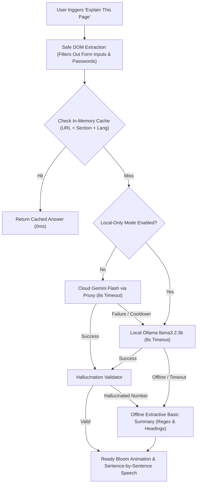

# 🌙 Sleepwalker - Voice Web Assistant
**Wispr-Flow Style Voice Assistant for Accessible Web • Manifest V3 Chrome Extension (Plain JavaScript, HTML & CSS — Zero Build Step)**

[](manifest.json)
[-blue?style=flat-square)](background.js)
[](widget.css)
[-orange?style=flat-square)](voice.js)
[](explain.js)
[](https://drive.google.com/drive/folders/1Q9A8rml4AuczycImQmk1X-EUSb0Usa1q?usp=sharing)
[](https://github.com/vatsalpro/sleep)

---

## 📺 Demo Video

Watch the complete prototype walkthrough and demonstration video:
🎥 **[Watch Sleepwalker Video Demo on Google Drive](https://drive.google.com/drive/folders/1Q9A8rml4AuczycImQmk1X-EUSb0Usa1q?usp=sharing)**

Highlights covered in the demo:
- **Wispr-Flow Floating Pill:** Seamless drag-and-drop, real-time equalizer wave animations, companion bubble.
- **Signature "Explain This Page":** Full-screen prism glow edge overlay with center readability mask.
- **Sentence-by-Sentence Speech:** Dynamic active sentence highlighting in English and Hindi.
- **Strict DOM Privacy:** Form inputs, textareas, and `<input type="password">` fields strictly excluded.
- **Side Panel Settings:** Local-Only Mode, Ollama connection testing, and microphone setup diagnostics.

---

## 🎯 What Sleepwalker Does

Millions of low-vision, low-literacy, and elderly users struggle to navigate complex digital public services — such as state scholarship portals, welfare schemes, and university admissions. These pages are often walls of bureaucratic text with buried deadlines, complex fee structures, and required document checklists.

**Sleepwalker** turns any website into an intuitive, voice-controlled assistive experience:
1. **Always-On Floating Pill:** A compact, non-intrusive floating pill (Wispr Flow style) rests at the bottom-right of every webpage. Draggable anywhere, with position remembered across reloads.
2. **Signature "Explain This Page":** In one click or voice command (*"Explain this page"* or *"पेज समझाओ"*), Sleepwalker extracts the essential purpose, fees, dates, and required documents into a clear summary under 120 words.
3. **Full-Screen Prism Glow:** While listening or preparing, screen borders illuminate in a soft, transparent prism glow (cyan, violet, pink, amber) that blooms bright when the answer is ready, leaving the central 72% of the page completely transparent and readable.
4. **Sentence-by-Sentence Speech & Highlighting:** Speech synthesis highlights each sentence as it speaks aloud in English (`en-IN`) or Hindi (`hi-IN`).
5. **Strict DOM Privacy:** User passwords, text fields, and form inputs are **100% stripped and excluded**. Credentials are never read aloud or transmitted.
6. **Hallucination Validator:** Numbers, amounts, and dates in the model's answer are strictly cross-referenced against the page text. Hallucinated sentences are automatically dropped.

---

## 📁 Repository Structure

```text
sleepwalker/
├── manifest.json       # Manifest V3 config + options_ui (no extra permissions)
├── background.js       # Service worker: toggle, script injection, LLM cascade, shelf IDB & options launcher
├── content.js          # Lightweight coordinator connecting all logic modules directly to SW_UI (Alt+S/Alt+Z/Escape)
├── orb.js              # window.SW_UI & __SW_UI_DEMO__: 78px frosted bottom-centre orb + 7 waveform bars
├── threads.js          # HiDPI Shadow-DOM canvas: 4 golden edge/perimeter ribbons, max-40 petals, veil & dissolve
├── card.js             # Frosted warm-white card (28px radius, sparkle header, tail, topics, confirm, file, pin, 6s hide)
├── ui.css              # Shadow-DOM design tokens & GPU-only transform/opacity animations (stops on idle)
├── options.html / .js  # Full-tab Options page (proxy, Ollama, local-only, glow on/off, barge-in, non-sensitive profile)
├── intent.js           # 13-intent engine, Devanagari/Hinglish normaliser, privacy gate & 0-LLM rule matcher
├── lexicon.json        # Multilingual EN / HI / Hinglish synonyms, Hinglish doc nouns & filler lexicon
├── link-index.js       # Viewport/shadow-DOM/iframe link indexer with 300-target budget & debug hook
├── link-intent.js      # Link action & positional parser (CLICK, FIND, FIND_THEN_CLICK, MORE_INFO, LIST)
├── link-lexicon.json   # EN / HI / Hinglish navigation triggers, ordinals, zones & card synonyms
├── match.js            # Cross-script phonetic skeleton matcher, Devanagari-Latin transliteration & ordinals
├── confirm.js          # Risk-based confirmation controller (critical double-confirm, timeouts) & plan stepper
├── digest.js           # Privacy-safe page digest, keyword chunk scorer & token budgets
├── explain.js          # Summary / action steps / Q&A modes, 3-turn memory & hallucination validator
├── llm.js              # Cascade engine: Cache -> Gemini / Proxy -> Ollama -> Offline + RPM & telemetry
├── navigate.js         # Voice navigation, 1s highlight, risky link confirm & cross-page session resume
├── form-index.js       # Multi-control form indexer (text, select, ARIA combobox, radios, switches, contenteditable)
├── form-fill.js        # EN/HI spoken number, date, phone & spelled-email parsers + non-sensitive summary
├── forms.js            # Guided & Free form-filling, validation error speech, multi-step resume & double-confirm submit
├── shelf-db.js         # Extension-origin IndexedDB store, 2-level 3000-file shelf index & Hinglish ranker
├── shelf.html / shelf.js # One-time showDirectoryPicker({mode:"read"}) & permission re-allow setup page
├── upload.js           # Route A Document Shelf + Route B 48px Choose File fallback, compression & undo
├── camera.js           # Permission helper (granted/prompt/denied), Shadow DOM 3-2-1 camera card & track cleanup
├── voice.js            # Web Speech API recognition, pauseTemporary/resumeAfterPause, Auto retry & 10 Indian langs
├── reader.js           # Content extractor, table parser, sentence-by-sentence SpeechSynthesis
├── outline.js          # H1-H4 heading extractor and fuzzy section matcher
├── mic-setup.html/.js  # Microphone onboarding, live Web Audio volume visualizer & hardware report
├── offscreen.html/.js  # Offscreen document host & evaluator
├── demo-portal.html    # Full scholarship portal fixture (nav links, forms, sensitive inputs, uploads)
├── test-sample.html    # Benchmark article & sign-in privacy test page
├── tests/              # Automated Node (P2-P7, L2-L3, phonetic) & Playwright Chromium E2E suites (L1/L4/L5, C1-C5)
├── icons/              # 16px, 48px, 128px high-DPI extension icons
└── proxy/              # Serverless proxy folder (keeps API keys off the client; requires GEMINI_MODEL)
    ├── worker.js       # Cloudflare Worker implementation (CORS, rate limiting, Gemini)
    ├── api/explain.js  # Vercel Serverless Function alternative
    ├── .env.example    # Environment variable template
    └── README.md       # Proxy deployment and security guide
```

---

## 🚀 Step-by-Step Installation Guide

Sleepwalker is built entirely with plain vanilla JavaScript, HTML, and CSS. It requires **no build step, no bundler, no npm install, and no TypeScript compilation**. It installs directly in Chrome in under 30 seconds.

### Step 1: Clone or Download the Repository
Open a terminal and clone the repository:
```bash
git clone https://github.com/vatsalpro/sleep.git
```
*(Alternatively, download the ZIP archive from GitHub and extract it to a local folder, e.g. `D:\sleep`).*

### Step 2: Open Extensions in Google Chrome
1. Open **Google Chrome** (or Microsoft Edge, Brave, or any Chromium-based browser).
2. In the address bar, type:
   ```text
   chrome://extensions
   ```
   and press Enter.

### Step 3: Enable Developer Mode
1. In the top-right corner of the Extensions page, locate the toggle labeled **"Developer mode"**.
2. Turn this toggle **ON**. Additional toolbar buttons (*Load unpacked*, *Pack extension*, *Update*) will appear on the top-left.

### Step 4: Load the Unpacked Extension
1. Click the **"Load unpacked"** button in the top-left corner.
2. In the folder picker dialog, select the cloned `sleep` folder (e.g. `D:\sleep`).
3. Click **Select Folder**.
4. The extension card **"Sleepwalker - Voice Web Assistant"** will appear immediately with its full feature set active.

### Step 5: Pin the Extension to Chrome Toolbar
1. Click the **puzzle piece icon** (Extensions menu) in Chrome's top toolbar.
2. Find **Sleepwalker** in the list and click the **Pin** icon next to it so the moon icon (`🌙`) is always visible.

### Step 6: (Optional) Allow Access to File URLs
If you plan to test Sleepwalker on local HTML files (like `file:///D:/sleep/test-sample.html`):
1. On the `chrome://extensions` page, click **Details** on the Sleepwalker card.
2. Scroll down and toggle ON **"Allow access to file URLs"**.
*(Note: On regular websites like Wikipedia or any live portal, Sleepwalker works immediately without this step).*

---

## 🤖 Detailed AI Model Setup Guide

Sleepwalker supports **three flexible AI execution modes**. You can use 100% private local offline models, high-speed cloud models via a secure proxy, or the built-in offline extractive fallback with zero setup.



---

### Option A: Local Ollama (Recommended — 100% Private, Free & Offline)

Running Ollama on your computer allows Sleepwalker to generate explanations locally. **No data ever leaves your computer, zero internet connection is required for AI, and there are no API costs or quotas.**

#### Step 1: Install Ollama
Download and install Ollama for your operating system:
- **Windows / macOS / Linux:** Download from **[https://ollama.com/download](https://ollama.com/download)**.
- Follow the standard installer instructions.

#### Step 2: Download the Recommended Model
Open your terminal (PowerShell, Command Prompt, or Terminal) and run:
```bash
ollama run llama3.2:3b
```
> **Tip:** The `llama3.2:3b` model (~2 GB) is optimized for high-speed edge reasoning and fits easily into system RAM or laptop GPUs. You can also use other models such as `qwen2.5:3b`, `qwen2.5:1.5b`, or `phi3:mini`.

#### Step 3: Verify Ollama is Running
Ensure the Ollama background service is active by testing its HTTP endpoint in your terminal or browser:
```bash
curl http://localhost:11434/api/tags
```
If you see JSON containing `"models": [...]`, Ollama is running and ready.

#### Step 4: Configure Sleepwalker
1. Open any webpage and press <kbd>Alt+S</kbd> (or click the toolbar icon) to slide open the Sleepwalker side panel.
2. Scroll to the **⚙️ AI & Prism Glow Settings** card.
3. Check the box for **"Local-Only Mode (Skip Cloud Gemini; use Ollama/Offline)"**.
4. Confirm the fields:
   - **Local Ollama URL:** `http://localhost:11434`
   - **Ollama Model Name:** `llama3.2:3b`
5. Click **"🔌 Test Connection"**.
   - Chrome will show a one-time runtime permission dialog requesting access to `http://localhost:11434/*`. Click **Allow**.
   - You will see a green badge: `✅ Local Ollama online! Available models: llama3.2:3b`.
6. Click **"💾 Save Settings"**.

---

### Option B: Cloud Gemini via Serverless Proxy (Fastest & Highest Quality)

For ultra-low latency and multilingual fluency across English, Hindi, and regional Indian languages, Sleepwalker can call Google's **Gemini** model using the `GEMINI_MODEL` environment variable (Gemini 1.5 is retired; set e.g. `gemini-2.5-flash-lite` — the proxy fails loudly with HTTP 500 if `GEMINI_MODEL` is unset).

> [!IMPORTANT]
> **Why use a Serverless Proxy?**
> Chrome extension packages are distributed as plain JavaScript. Hardcoding an API key inside client extension files exposes it to anyone who inspects DevTools or unzips the CRX. The proxy securely holds `GEMINI_API_KEY` and `GEMINI_MODEL` on your own serverless worker, rate-limits requests per IP, restricts CORS to Chrome extensions, and never logs user page text.

#### Step 1: Get a Free Gemini API Key
1. Visit **[Google AI Studio](https://aistudio.google.com/app/apikey)**.
2. Sign in with your Google account.
3. Click **"Create API Key"**.
4. Copy your generated key (`AIzaSy...`).
*(The Google AI Studio free tier provides 15 requests per minute with no credit card required).*

#### Step 2: Deploy the Serverless Proxy

##### Sub-option 1: Deploy to Cloudflare Workers (Recommended — Free 100k requests/day)
1. Open a terminal and navigate to the `proxy` folder:
   ```bash
   cd proxy
   ```
2. Install the Cloudflare CLI tool (Wrangler):
   ```bash
   npm install -g wrangler
   ```
3. Log in to your Cloudflare account:
   ```bash
   wrangler login
   ```
4. Set your Gemini API key as a secure secret:
   ```bash
   wrangler secret put GEMINI_API_KEY
   ```
   *(Paste your API key when prompted).*
5. Deploy the worker:
   ```bash
   wrangler deploy worker.js --name sleepwalker-proxy
   ```
6. Wrangler will output your live URL, for example:
   ```text
   https://sleepwalker-proxy.<your-subdomain>.workers.dev
   ```

##### Sub-option 2: Deploy to Vercel (Alternative)
1. Navigate to the `proxy` folder:
   ```bash
   cd proxy
   ```
2. Deploy using Vercel CLI:
   ```bash
   npm install -g vercel
   vercel
   ```
3. In the Vercel Project Settings / Cloudflare Secrets dashboard, add Environment Variables:
   - `GEMINI_API_KEY`: Your Gemini API key
   - `GEMINI_MODEL`: Active Gemini model name (required, e.g., `gemini-2.5-flash-lite`; proxy returns HTTP 500 if missing)
4. Your endpoint will be `https://<your-project>.vercel.app/api/explain`.

#### Step 3: Connect the Proxy to Sleepwalker
1. Open the Sleepwalker side panel with <kbd>Alt+S</kbd>.
2. In **⚙️ AI & Prism Glow Settings**, paste your proxy URL into the **Cloud Serverless Proxy URL** field.
3. Click **"🔌 Test Connection"** and allow the permission prompt.
4. Click **"💾 Save Settings"**.

---

### Option C: Built-in Offline Extractive Fallback (Zero Setup Required)

If neither Ollama nor a Cloud Proxy is configured, Sleepwalker **works immediately out of the box with zero external dependencies**:
- Analyzes document semantic roots (`<main>`, `<article>`, `[role=main]`).
- Extracts headings and identifies document structure.
- Applies localized regex patterns to detect:
  - **Fees & Amounts:** e.g. `1,200 INR`, `₹50`, `$50 USD`
  - **Deadlines & Dates:** e.g. `January 15, 2027`, `31 October`
  - **Required Documents:** e.g. `domicile certificate`, `marks sheets`, `income certificate`
- Formulates a concise 3–5 sentence explanation in English or Hindi in **0 milliseconds with zero network requests**.
- The output is clearly marked with: `[Source: basic summary]`.

---

## ⌨️ How to Use Every Feature

### 1. The Floating Pill (Wispr-Flow Style)
- **Always Visible:** The round 56px pill rests at the bottom-right of every webpage.
- **Draggable:** Click and drag the pill to any position on the screen. Its coordinates are saved per-site.
- **Equalizer Sound Bars:** Animated equalizer waves pulse green when speaking and amber when preparing.
- **Companion Bubble:** Click the pill to open the bubble. From here, you can:
  - Type a command and press Enter.
  - Click **"✨ Explain"** to analyze the page.
  - Click **"⏹️ Stop"** to cancel reading or processing.
  - Click **"Expand"** to slide open the full side panel.

### 2. Click-to-Talk & Hold-to-Talk
- **Click-to-Talk:** Click the microphone icon on the pill or panel. Speak your command. If you pause for 2 seconds, Sleepwalker auto-commits and executes your command.
- **Hold-to-Talk (<kbd>Alt+Z</kbd>):** Hold down <kbd>Alt+Z</kbd> on any webpage, speak your command, and release the keys to execute instantly.
- **Emergency Stop (<kbd>Escape</kbd>):** Press <kbd>Escape</kbd> at any time to immediately abort speech synthesis, stop voice recognition, and turn off prism glow.

### 3. Full Side Panel (<kbd>Alt+S</kbd>)
Press <kbd>Alt+S</kbd> or click the toolbar icon to access:
- **Language Switch:** Toggle between **🇮🇳 EN** (English - India) and **🇮🇳 HI** (Hindi - India).
- **Text Size Controls:** Switch between 18px, 22px, and 26px for high-legibility viewing.
- **Speech Speed Controls:** Adjust reading speed (0.8x slow, 1.0x normal, 1.2x fast).
- **Outline View:** Click **"📑 Outline"** to extract all headings with 1-click read buttons.
- **Microphone Setup (`🎙️ Setup`):** Launches `mic-setup.html` with real-time Web Audio input meters.

---

## 🗣️ Bilingual Voice & Typed Commands Reference

| Action | English Spoken / Typed Command | Hindi Spoken / Typed Command |
| :--- | :--- | :--- |
| **Explain Page** | `"Explain this page"`, `"Explain"` | `"पेज समझाओ"`, `"सरल भाषा में बताओ"` |
| **Explain Section** | `"Explain the fees section"` | `"फीस सेक्शन समझाओ"` |
| **Read Entire Page** | `"Read this page"`, `"Start reading"` | `"यह पेज पढ़ो"`, `"सुनाओ"` |
| **Read Specific Section** | `"Read the eligibility section"` | `"योग्यता पढ़ो"` |
| **Show Headings** | `"Outline"`, `"Show headings"` | `"आउटलाइन"`, `"रूपरेखा"` |
| **Pause Speech** | `"Pause"`, `"Wait"` | `"रोको"`, `"पॉज़"` |
| **Resume Speech** | `"Resume"`, `"Continue"` | `"आगे पढ़ो"`, `"जारी रखो"` |
| **Stop Speech** | `"Stop"`, `"Cancel"` | `"बंद करो"`, `"शांत"` |
| **Repeat From Start** | `"Read it again"`, `"Repeat"` | `"फिर से पढ़ो"`, `"दोहराओ"` |
| **Help & Instructions** | `"Help"`, `"Commands"` | `"मदद"`, `"सहायता"` |

---

## 🔒 Privacy & Security Guarantees

1. **Zero Form or Password Capture:** Sleepwalker's Safe Text Extractor explicitly drops all `input`, `textarea`, `select`, `button`, and `input[type="password"]` elements. Form values and credentials are never read aloud, highlighted, or transmitted.
2. **Encapsulated Shadow DOM:** All extension UI elements, animations, and styles reside inside an isolated Shadow DOM (`#sleepwalker-host`), preventing CSS conflicts and ensuring no page layout shifts.
3. **No External Scripts:** Does not load any remote JavaScript or analytics scripts. Strictly complies with Chrome Manifest V3 security boundaries.
4. **Transient Zero-Log Proxy:** The `/proxy` serverless code acts solely as a stateless pass-through to the Gemini API and never writes user page text to disks or database logs.

---

## 🌍 Multilingual Support, Intents, Safety & Honest Limits

- **13 Voice/Typed Intents (`>=70%` Zero-LLM Rule Resolution):** Normalises Devanagari numerals (`१२३ -> 123`), Hinglish spelling variants (`samjhaao -> samjhao`), and noisy fillers locally using [lexicon.json](lexicon.json) before invoking at most one compact JSON LLM call (`<=300` input / `<=60` output tokens) when confidence `< 0.75`.
- **Continuous Conversation Mode (`dialogue.js`):** <kbd>Alt+S</kbd> or tapping the floating orb starts a continuous listen → act → speak → listen loop until an EN/HI/Hinglish END phrase (`thanks`, `that's all`, `bye`, `bas`, `bas itna hi`, `shukriya`, `dhanyavaad`, `theek hai bas`, `band karo`). Half-done forms ask `"Stop now? Your form stays as it is."` first. Half-duplex mode pauses speech recognition while speaking (~300 ms resume delay; optional **Barge-in** toggle in Settings for headphones), auto-restarts on Chrome's ~60 s recognition cut-offs, prompts `"Are you still there?"` after 25 s of silence (ends quietly +15 s later), interprets replies answer-first (`skip`, `back`, `repeat`, `help`, `undo`, `"no, change it to..."`), and keeps a redacted 3-turn memory.
- **Complete Voice Form Engine (`form-index.js`, `form-fill.js`, `forms.js`):** Indexes visible inputs (`text`, `number`, `email`, `tel`, `date`, `textarea`, `select`, ARIA `combobox`/`listbox`, `radio`, `checkbox_group`, hidden inputs paired with labels, `[role=switch]`, `contenteditable`) across open shadow roots and same-origin iframes. Supports Guided (`"fill this form"` with progress, 6-item option paging/`"more"`, and phonetic fuzzy matching for long State/Country dropdowns) & Free mode (`"select Karnataka in state"`, `"set gender to female"`, `"tick blue and black"`, `"write my city as Mysuru"`, `"clear that"`). Parses EN/HI numbers, digit-by-digit phones, dates (`"fifteen August two thousand five"`, Hindi months, `aaj`/`kal`), spelled emails, and long dictation until `"that's all"`. Verifies every applied DOM value, speaks validation errors aloud, resumes multi-step `Next` forms via `chrome.storage.session`, supports manual takeover (`"I'll do this one"`), and guards critical **Submit/Pay** buttons with a non-sensitive summary + double confirmation (`haan`, `nahi`, `theek hai`, `kar do`, `ruko`).
- **Privacy & Confirmation Tiers (`confirm.js`, `intent.js`, `digest.js`):** Risk policy enforces 0 confirms (`low`), confirm if unsure (`medium`), explicit confirm (`high`: upload, camera, external nav), and summary + double confirm (`critical`: submit/payment), cancelling on timeout. Digests and LLM calls NEVER include form values, file data/names, captured images, passwords, OTPs, Aadhaar, PAN, card/CVV, bank accounts, UPI PINs, or CAPTCHAs (*"Please enter this one yourself. Say done when finished."*).
- **File Upload Without OS Dialog Control (`shelf.html`, `shelf-db.js`, `upload.js`):**
  - *Route A (Document Shelf):* One-time setup in `shelf.html` saves a `showDirectoryPicker({mode:"read"})` handle in extension IndexedDB, indexes up to 2 levels / 3,000 filenames locally, fuzzy-matches Hinglish synonyms (`tasveer`, `marksheet`, `resume`, `income certificate`), previews/confirms, resizes oversized images via Canvas under size caps (reporting honestly that PDFs cannot be compressed), and attaches via `DataTransfer` (honest browser reality: Chrome requires a single user tap for `requestPermission()` after restart).
  - *Route B (One-Tap Fallback):* Highlights the field or dropzone and renders a large **Choose File** button so the user's tap provides the required Chrome user activation.
- **Camera Capture & Permission Helper (`camera.js`, `pill.js`):** Handles `take a photo` / `use camera` / `input[capture]`, checks `navigator.permissions.query({name:"camera"})` (`granted`, `prompt` address-bar guide before `getUserMedia`, or `denied` with exact lock/tune icon -> Site settings -> Camera -> Allow instructions), renders an encapsulated 3-2-1 Shadow DOM capture preview with `Retake` / `Use this`, converts/resizes to JPEG, attaches via `DataTransfer`, and stops all `MediaStreamTracks` immediately so the hardware camera light turns off.
- **Languages Supported:** `Auto` (`hi-IN` default for Hinglish with a single automatic `en-IN` retry on low confidence), `en-IN`, `hi-IN`, plus `ta-IN`, `te-IN`, `bn-IN`, `mr-IN`, `gu-IN`, `kn-IN`, `ml-IN`, and `pa-IN` (speech recognition + TTS by language code, compact LLM intent & reply in the user's language).
- **Minimal Permissions (`manifest.json`):** Only `activeTab` (inject into current user-triggered tab), `scripting` (content UI & form/upload helpers), `storage` (`chrome.storage.local` preferences/non-sensitive opt-in profile & `chrome.storage.session` multi-step form resume), `offscreen` (mic diagnostics fallback). Camera and microphone use the standard browser permission prompt at point-of-use — zero extra camera permission declared, and zero remote code or analytics.

---

## ✅ Judge & Developer Test Checklist

### Automated Verification (Zero Network Required)
Run the phase suites and headless Chromium Playwright E2E checks from `D:\sleep`:
- `node tests/run-p2-tests.js` .. `node tests/run-p7-tests.js` — Intent EN/HI/Hinglish normaliser & rules (`>=70%`), privacy digest, voice navigation, form parsers/guards, file compression/upload, multilingual retries, and `node --check` across all 27 extension `.js` files
- `node tests/test_l2_match.js`, `node tests/test_l3_link_intent.js`, `node tests/test_phonetic_nav.js` — Phonetic/cross-script link matching & parser tables
- `python tests/test_l1_link_index.py`, `python tests/test_l4_acting.py`, `python tests/test_l5_full_suite.py`, `python tests/test_bugfix_nav.py` — Link index, shadow/iframe traversal, acting & 3-fixture suite
- `python tests/test_c1_dialogue.py` — Continuous conversation session, END phrases, half-done form guard, answer-first interpretation, half-duplex pause & silence timeout
- `python tests/test_c2_forms.py` — All form control types (combobox, switches, hidden checkboxes, radios, contenteditable), EN/HI numbers/dates/emails, verification, sensitive verify-without-reading, multi-step resume
- `python tests/test_c3_upload.py` — Route A IndexedDB/ranker + confirm flow + Route B Choose File & oversized image compression
- `python tests/test_c4_camera.py` — Camera permission helper (`denied` / `prompt` / `granted`), countdown capture, JPEG attachment & immediate track stop
- `python tests/test_c5_integration.py` — Full unified Fixture E2E (`Alt+S`, `window.__SW_SAY__`, all 18 form/file/button controls, fake-device camera, route guard proving zero unauthorized outbound requests)
- `python tests/playwright_e2e.py` — Core `demo-portal.html` end-to-end E2E suite

### Siri-Style Translucent UI & Honest Voice-Sync Notes
- **Website-First Invocation (`orb.js`, `threads.js`, `card.js`, `ui.css`):** Idle state leaves zero DOM UI and zero running animations on the webpage. Pressing <kbd>Alt+S</kbd> (or toolbar icon; hold <kbd>Alt+Z</kbd> for push-to-talk) summons the 78 px frosted bottom-centre orb, luminous golden edge ribbons (`max 40` petals, `<=10%` veil tint), and frosted warm-white response cards (`45vh` cap, overflow Expand, progressive topic/sentence reveal, Pin, target avoidance, and `6 s` auto-dismiss unless hovered/focused/sticky). Settings live in `options.html` (`options_ui`).
- **Approximated Audio Reactivity (Honest Browser Disclosure):**
  - *Listening:* Attempts a local `AudioContext` `AnalyserNode` RMS level meter only when mic permission is already granted alongside `SpeechRecognition`; where browsers prevent concurrent mic access or sound isn't exposed, falls back cleanly to a synthetic listening waveform envelope boosted by interim transcripts (`voice.js`).
  - *Speaking:* Chrome `SpeechSynthesis` exposes no raw PCM audio stream. Waveform bars animate from `utterance.onboundary` word/sentence events where supported and smoothly fall back to an approximated synthetic speech envelope on voices without boundary callbacks (`reader.js`).
- **Additional UI Verification (`tests/test_ui_p1.py` .. `tests/test_ui_final.py`):** Headless Chromium checks at `1440x900` & `1024x700` capturing every orb/card state screenshot, verifying zero idle visibility/animations, zero layout shift, `>=4.5:1` card contrast, target-avoidance, hover auto-dismiss pause, `Escape` dismissal, and `prefers-reduced-motion`. Cannot automate real live audio mic levels, real subjective voice-sync feel across OS voices, or OS-installed Hindi TTS voices (verify manually in Chrome after reloading).
Automated tests inject transcripts via `window.__SW_SAY__`, mock SpeechSynthesis/SpeechRecognition/LLM/IndexedDB-handle seams, and use Chromium fake media streams. Always manually check in real Google Chrome:
- [ ] **Real Hindi/Hinglish Live Speech (`SpeechRecognition`):** Speak Hinglish and regional phrases aloud in `Auto` (`Alt+S`) and confirm real mic recognition + `hi-IN -> en-IN` retry behavior.
- [ ] **File Shelf Permissions Across Browser Restart (`shelf.html`):** Connect a local folder via `showDirectoryPicker({mode:"read"})`, restart Chrome, upload a file, and verify the one-tap `requestPermission()` prompt re-grants access cleanly.
- [ ] **Real Hardware Camera & Permission Bar:** Test `take a photo` on a real webcam under both `prompt` and `denied` site settings, confirming the hardware LED turns off immediately after capture/cancel.
- [ ] **Real Gemini Proxy & Local Ollama:** Point Settings to your live proxy (`GEMINI_MODEL` set) or `ollama run llama3.2:3b` and inspect **Settings → Diagnostics** and Network tab to confirm zero sensitive form values or file names ever leave.

---

## ⚖️ Open Source & License

Developed for the **CodeQuest National Tech Hackathon 2026**. Distributed under the open-source MIT License.
